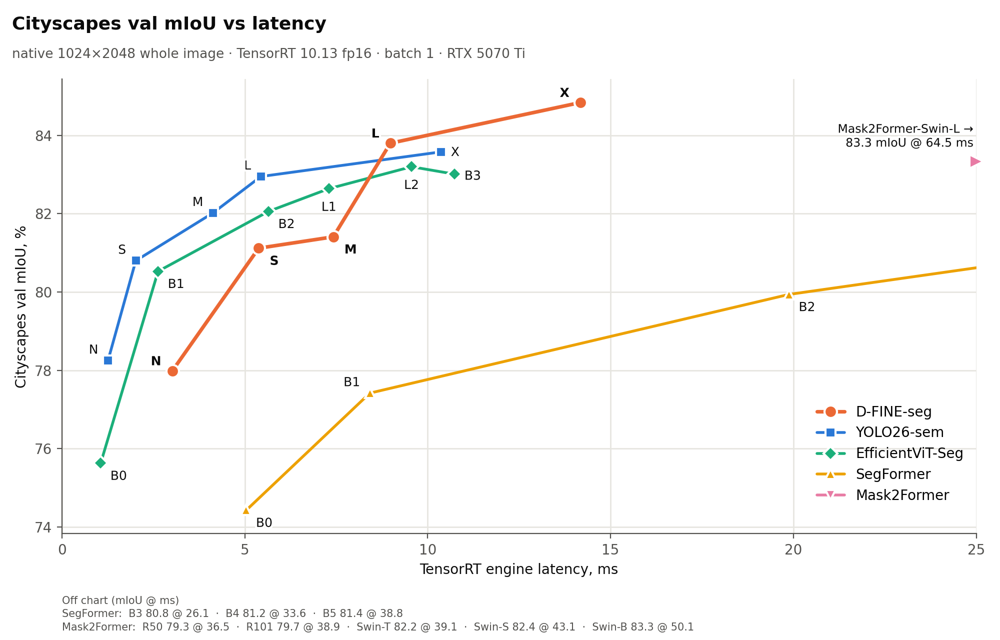

# Cityscapes benchmark: D-FINE-seg vs YOLO26, EfficientViT-Seg, SegFormer, Mask2Former, RF-DETR

Like-for-like benchmarks on Cityscapes. Every model runs through its own framework's shipped
inference code and is scored by one scorer.

The model under test is **[D-FINE-seg](https://github.com/ArgoHA/D-FINE-seg)**: real-time
detection, instance and semantic segmentation, Apache-2.0 code, `pip install dfine-seg`. The
Cityscapes weights benchmarked here are on [Hugging Face](https://huggingface.co/ArgoSA/D-FINE-seg)
and load with `load_model("x", task="sem_seg")`.

- **[Semantic segmentation at native 1024×2048](#semantic-segmentation-at-native-10242048)**:
  D-FINE-seg N–X against the official Cityscapes checkpoints of four other families.
- **[Round 1: detection, instance and semantic segmentation at 640](#round-1-detection-instance-and-semantic-segmentation-at-640)**:
  D-FINE-seg vs YOLO26 vs RF-DETR, every model trained by us.
- **[PROTOCOL.md](PROTOCOL.md)**: how every number was produced, and every asymmetry we know of (§9).

## Semantic segmentation at native 1024×2048

28 models: the five D-FINE-seg sizes, trained here, and 23 official Cityscapes checkpoints from
four families (YOLO26-sem n–x, EfficientViT-Seg B0–L2, SegFormer B0–B5, Mask2Former R50–Swin-L),
none of them retrained. Every model sees the whole 1024×2048 frame in one forward pass and is
scored at 1024×2048 on the 500 val images. Each runs its own framework's pre- and postprocessing.
TensorRT 10.13.3.9 fp16, batch 1, one idle RTX 5070 Ti.


End-to-end latency is what a user's pipeline pays: each framework's own preprocessing, the
engine and its own postprocessing. On pure TensorRT engine time, YOLO26 is faster at every size
letter:



[`native/plot_semseg_native.py`](native/plot_semseg_native.py) also draws log-axis and broken-axis versions with every model on the chart.

| model | params (M) | GMACs | mIoU | pixel acc | engine ms | e2e ms |
|---|---:|---:|---:|---:|---:|---:|
| **D-FINE-seg-N** | 3.36 | 81.5 | 77.99 | 96.03 | 3.02 | 4.21 |
| **D-FINE-seg-S** | 7.99 | 213.8 | 81.12 | 96.47 | 5.38 | 6.37 |
| **D-FINE-seg-M** | 15.95 | 295 | 81.41 | 96.55 | 7.42 | 8.26 |
| **D-FINE-seg-L** | 24.97 | 380.4 | 83.80 | 96.93 | 8.98 | 9.77 |
| **D-FINE-seg-X** | 56.3 | 670.1 | **84.84** | **97.10** | 14.18 | 14.64 |
| YOLO26n-sem | 1.63 | 11.9 | 78.25 | 95.84 | 1.26 | 4.71 |
| YOLO26s-sem | 6.49 | 45.5 | 80.80 | 96.33 | 2.02 | 5.52 |
| YOLO26m-sem | 14.3 | 152.7 | 82.02 | 96.47 | 4.13 | 7.54 |
| YOLO26l-sem | 17.85 | 194.1 | 82.95 | 96.65 | 5.44 | 8.77 |
| YOLO26x-sem | 40.13 | 433.5 | 83.58 | 96.79 | 10.37 | 13.58 |
| EfficientViT-B0 | 0.71 | 4.4 | 75.63 | 95.71 | 1.06 | 11.90 |
| EfficientViT-B1 | 4.8 | 25.1 | 80.53 | 96.48 | 2.63 | 13.35 |
| EfficientViT-B2 | 15.32 | 73.6 | 82.06 | 96.71 | 5.65 | 16.25 |
| EfficientViT-L1 | 40.24 | 282.5 | 82.64 | 96.78 | 7.30 | 17.78 |
| EfficientViT-L2 | 52.61 | 396.1 | 83.20 | 96.87 | 9.56 | 19.87 |
| EfficientViT-B3 | 39.6 | 179.2 | 83.01 | 96.85 | 10.74 | 21.58 |
| SegFormer-B0 | 3.72 | 121 | 74.43 | 95.65 | 5.04 | 8.78 |
| SegFormer-B1 | 13.68 | 239.1 | 77.42 | 96.10 | 8.42 | 12.32 |
| SegFormer-B2 | 27.36 | 703.5 | 79.94 | 96.40 | 19.88 | 23.46 |
| SegFormer-B3 | 47.24 | 949.2 | 80.77 | 96.54 | 26.13 | 29.43 |
| SegFormer-B4 | 64.01 | 1226.8 | 81.15 | 96.55 | 33.58 | 36.78 |
| SegFormer-B5 | 84.61 | 1446.4 | 81.41 | 96.62 | 38.81 | 42.12 |
| Mask2Former-R50 | 44.01 | 519.6 | 79.30 | 96.42 | 36.49 | 66.51 |
| Mask2Former-R101 | 63 | 674.7 | 79.72 | 96.37 | 38.85 | 68.93 |
| Mask2Former-Swin-T | 47.41 | 533.4 | 82.19 | 96.66 | 39.13 | 69.33 |
| Mask2Former-Swin-S | 68.72 | 719.4 | 82.43 | 96.81 | 43.11 | 73.32 |
| Mask2Former-Swin-B | 106.89 | 1045.9 | 83.29 | 96.91 | 50.09 | 79.85 |
| Mask2Former-Swin-L | 215.46 | 1899.4 | 83.33 | 96.91 | 64.51 | 94.07 |

Cityscapes val, 500 images, mIoU and pixel accuracy in %. **engine ms** is TensorRT execute
only, the same loop for every engine. **e2e ms** is the framework's own inference call, with
image decode and the device-to-host copy of the result outside the clock. GMACs are recounted
for every model with one counter at 1024×2048. Generated tables, per-class IoU and the
published numbers: [`RESULTS_SEMSEG_NATIVE.md`](results/RESULTS_SEMSEG_NATIVE.md) /
[`RESULTS_SEMSEG_NATIVE.csv`](results/RESULTS_SEMSEG_NATIVE.csv).

### What the table shows

- **D-FINE-seg-L vs YOLO26-x** (the most accurate YOLO26-sem): +0.22 mIoU, +0.14 pixel accuracy, 13%
  lower engine latency (8.98 vs 10.37 ms), 28% lower end-to-end latency (9.77 vs 13.58 ms), 38%
  fewer parameters. One training seed and a small margin, so read it as "matches or beats". L's
  last-epoch checkpoint is +0.04 mIoU over YOLO26-x.
- **D-FINE-seg-X vs Mask2Former Swin-L** (the most accurate Mask2Former): +1.51 mIoU, 4.5× lower
  engine latency, 6.4× lower end-to-end latency, about a quarter of the parameters. X has the
  highest mIoU and pixel accuracy of the 28 models.
- **Cityscapes test** (held-out 1525 images, official evaluation server): D-FINE-seg-X 83.23 vs YOLO26-x 82.10 mIoU, so the val margin holds on test.
- **Size by size against YOLO26-sem**, the closest rival on latency:

  | size | D-FINE-seg mIoU / px acc | YOLO26-sem mIoU / px acc | Δ mIoU | Δ px acc | engine ms (D-FINE / YOLO) | e2e ms (D-FINE / YOLO) | params M (D-FINE / YOLO) |
  |---|---|---|---:|---:|---|---|---|
  | N | 77.99 / 96.03 | 78.25 / 95.84 | -0.26 | +0.19 | 3.02 / 1.26 | 4.21 / 4.71 | 3.36 / 1.63 |
  | S | 81.12 / 96.47 | 80.80 / 96.33 | +0.32 | +0.14 | 5.38 / 2.02 | 6.37 / 5.52 | 7.99 / 6.49 |
  | M | 81.41 / 96.55 | 82.02 / 96.47 | -0.61 | +0.08 | 7.42 / 4.13 | 8.26 / 7.54 | 15.95 / 14.3 |
  | L | 83.80 / 96.93 | 82.95 / 96.65 | +0.85 | +0.28 | 8.98 / 5.44 | 9.77 / 8.77 | 24.97 / 17.85 |
  | X | 84.84 / 97.10 | 83.58 / 96.79 | +1.26 | +0.31 | 14.18 / 10.37 | 14.64 / 13.58 | 56.3 / 40.13 |

  At equal size letter, YOLO26-sem has the lower engine latency everywhere. D-FINE-seg-N is level
  with YOLO26-n (−0.26 mIoU, +0.19 pixel accuracy, lower end-to-end latency). D-FINE-seg-M sits
  below YOLO26-m.
- **Engine vs end-to-end latency differ a lot.** Pre- and postprocessing in the shipped Python
  path can double the latency (EfficientViT-L2: 9.56 ms engine, 19.87 ms end to end). Engine ms
  is the architecture number; e2e ms is what each framework's shipped code delivers.

### Disclosures

These apply to every comparison above. The full list, with the reproduction and fp16 gates, is in
[PROTOCOL.md §9](PROTOCOL.md#9-things-that-could-still-make-this-unfair).

- **Init.** D-FINE-seg S/M/L/X start from Objects365 → COCO detection weights (`obj2coco`); N
  starts from COCO detection, because no `obj2coco` N checkpoint exists. YOLO26-sem starts from
  COCO instance-seg weights; EfficientViT, SegFormer and Mask2Former from ImageNet.
- **Checkpoint selection.** D-FINE-seg's `model.pt` is the best epoch on the same val set. Its
  last-epoch val mIoU is lower by 0.23 (X) to 0.93 (M); see the table below.
- **Mask2Former** was trained on 512×1024 crops for 90k iterations at batch 16 (≈480 epochs);
  Swin-B/L start from ImageNet-21k. Under TensorRT fp16, Mask2Former-R101 loses 0.39 mIoU against
  its PyTorch run. This is diffuse fp16 noise, so it is disclosed rather than pinned.
- **EfficientViT** runs with its `LiteMLA` attention pinned to fp32 in the engine, as its own code
  does in PyTorch. A plain fp16 engine collapses B1–L1 to 2–6 mIoU.
- **SegFormer** is evaluated on the whole image like everyone else; its paper numbers use 1024×1024
  sliding windows. Our sliding-window run reproduces the paper within ±0.2 mIoU (PROTOCOL.md §9).
- **One seed** per D-FINE-seg size. D-FINE-seg trained 62–75 epochs; YOLO26-sem 220–240,
  SegFormer about 430, Mask2Former about 480.

Val mIoU / pixel accuracy of D-FINE-seg during training (PyTorch, from each run's log):

| size | best epoch | mIoU / pixel acc, best epoch | mIoU / pixel acc, last epoch (epoch) |
|---|---:|---|---|
| N | 57 | 78.00 / 96.02 | 77.51 / 95.97 (75) |
| S | 42 | 81.05 / 96.47 | 80.43 / 96.41 (70) |
| M | 27 | 81.45 / 96.56 | 80.52 / 96.55 (66) |
| L | 38 | 83.88 / 96.95 | 83.62 / 96.91 (65) |
| X | 42 | 84.80 / 97.10 | 84.57 / 97.03 (62) |

### Reproduce

Training configs, the D-FINE-seg commit and the train/export commands for the five D-FINE-seg
models: **[`train_configs/`](train_configs/)**.

The scripts expect one workspace directory that holds this repo, the data and the outputs, and a
D-FINE-seg checkout (its uv env runs the scorer, D-FINE-seg inference and the engine timing).
Every script runs from the repo root as a module, `python -m <folder>.<script>`:

```text
<root>/cityscapes-benchmark/    this repo
<root>/data/                    prep_datasets.py writes here
<root>/output/                  models, prediction dumps, bench CSVs
```

`CITYSCAPES_ROOT` overrides `<root>` (default: the parent of this repo) and `DFINE_SEG_ROOT` points
at the D-FINE-seg checkout (default: `../../D-FINE-seg`); see [`paths.py`](common/paths.py).

```bash
git clone https://github.com/ArgoHA/D-FINE-seg && (cd D-FINE-seg && uv sync)
export DFINE_SEG_ROOT=$PWD/D-FINE-seg
cd <root>/cityscapes-benchmark

# 1. data: the official zips (leftImg8bit_trainvaltest, gtFine_trainvaltest), unzipped
uv run --project "$DFINE_SEG_ROOT" python prep_datasets.py --only dataset_sem yolo_sem \
    --raw /path/to/cityscapes_raw

# 2. one venv per framework, all on TensorRT 10.13.3.9; pinned rival repos; Mask2Former weights
./setup_venvs.sh

# 3. rivals: table + fp16 gate (torch backend) + SegFormer paper reproduction (slide backend)
.venv-yolo/bin/python -m native.repro_yolo_val           # YOLO's own val must match its stored mIoU
uv run --project "$DFINE_SEG_ROOT" python -m native.bench_semseg_native \
    --families yolo segformer effvit mask2former --backends trt torch slide

# 4. add D-FINE-seg (1024x2048 TensorRT engines, see train_configs/) in one TRT session
uv run --project "$DFINE_SEG_ROOT" python -m native.bench_semseg_native --fresh 0 \
    --families dfine yolo segformer effvit mask2former \
    --dfine D-FINE-seg-N=<run>/model.engine D-FINE-seg-S=<run>/model.engine ...

# 5. tables and plot (CPU only)
uv run --project "$DFINE_SEG_ROOT" python -m native.make_results_native
for lat in e2e engine; do
  uv run --project "$DFINE_SEG_ROOT" python -m native.plot_semseg_native --latency $lat --xmax 25 \
      --pin Mask2Former-Swin-L --out results/semseg_native$([ $lat = engine ] && echo _engine).png
done
```

The bench refuses to run while another process holds the GPU, because latency would be wrong.
`--limit 5 --allow-busy-gpu` runs a quick smoke test on the first five val images. `--fresh 0`
reuses stored rival predictions; D-FINE-seg engines are always re-run.

| folder | contents |
|---|---|
| [`results/`](results/) | published tables (`RESULTS_SEMSEG_NATIVE.*`, round 1 `RESULTS.*`) and plots |
| [`native/`](native/) | native benchmark: [`bench_semseg_native.py`](native/bench_semseg_native.py) (entry point: every family in its own venv, scoring, engine timing, fp16 gate), [`repro_yolo_val.py`](native/repro_yolo_val.py) (YOLO26-sem reproduction gate through ultralytics' own val), [`make_results_native.py`](native/make_results_native.py) / [`plot_semseg_native.py`](native/plot_semseg_native.py) (tables / plot) |
| [`infer/`](infer/) | each framework's own shipped inference path: `infer_{dfine,yolo,efficientvit,segformer,mask2former,rfdetr}.py` |
| [`common/`](common/) | shared by both benchmarks: [`score.py`](common/score.py) (one scorer, D-FINE-seg's validators), [`dump.py`](common/dump.py) (timing loop and dump format), [`measure_engine.py`](common/measure_engine.py) (engine-only latency, one loop for every engine), [`build_engine.py`](common/build_engine.py) (ONNX → TensorRT fp16 at the venv's TRT version), [`trt_runner.py`](common/trt_runner.py) (TensorRT runner for the families that ship none), [`model_stats.py`](common/model_stats.py) (params and GMACs, one counter), [`paths.py`](common/paths.py) (workspace layout) |
| [`round1_640/`](round1_640/) | round 1: training, bench and results scripts |
| [`train_configs/`](train_configs/) | the five D-FINE-seg training configs |
| [`prep_datasets.py`](prep_datasets.py) / [`setup_venvs.sh`](setup_venvs.sh) | dataset layouts / venvs, pinned rival repos, Mask2Former weights |

## Round 1: detection, instance and semantic segmentation at 640

The first round (July 2026) compares three frameworks on three tasks: **detection**, **instance
segmentation** and **semantic segmentation**, with every model trained by us at 640 (RF-DETR at
its own default resolution). The semantic segmentation part is superseded by the native-resolution
benchmark above.

- **[PROTOCOL.md](PROTOCOL.md)** §1–10: how every model was trained, exported, timed and scored,
  plus every asymmetry that remains.
- **[RESULTS.md](results/RESULTS.md)** / **[RESULTS.csv](results/RESULTS.csv)**: the numbers.

### The rules this benchmark plays by

1. **Each framework runs its own shipped inference code.** `YOLO(engine).predict()` for
   ultralytics, `TRTInference` + their `PostProcess` for RF-DETR, `TRT_model` for D-FINE. We never
   hand-write a rival's pre/postprocessing — we compare *architecture + the framework it ships in*,
   because that is what a user actually gets.
2. **Accuracy and latency come from the same run**, at each model's **own** val-optimal confidence
   threshold. Reporting F1 at one threshold and latency at another is not a benchmark.
3. **Two latency columns**: the framework's end-to-end call, *and* pure TensorRT engine time. They
   disagree — the rivals' CPU preprocessing dominates end-to-end — and reporting only one of them
   would be misleading.
4. **Sizes are matched on latency, not parameters.** Each rival is the smallest variant with *at
   least* D-FINE's engine budget, so it is never under-resourced (it also carries 2–3× the params).
5. **One scorer for everyone**: D-FINE's `Validator`, original-resolution ground truth. It
   reproduces D-FINE's own `bench.py` output exactly — which is what makes the rival rows
   trustworthy.
6. **Every asymmetry we know about is written down** in [PROTOCOL.md §9](PROTOCOL.md), including
   the ones that don't flatter us.

### Quick start

```bash
python prep_datasets.py                          # dataset layouts (symlinks, original resolution)
./round1_640/run_yolo_training.sh               # train YOLO26
./round1_640/run_rfdetr_training.sh             # train RF-DETR
python -m round1_640.bench_all --models dfine yolo rfdetr   # bench: accuracy + latency at the same operating point
python -m round1_640.make_results                           # regenerate RESULTS.md / RESULTS.csv
```

Requires three isolated venvs (one per framework), each pinned to **TensorRT 10.13.3.9** so all
engines are mutually comparable. Paths follow the workspace layout above ([`paths.py`](common/paths.py)).

Hardware for the published numbers: single RTX 5070 Ti (16 GB), TensorRT 10.13.3.9, FP16, batch 1,
idle GPU.
