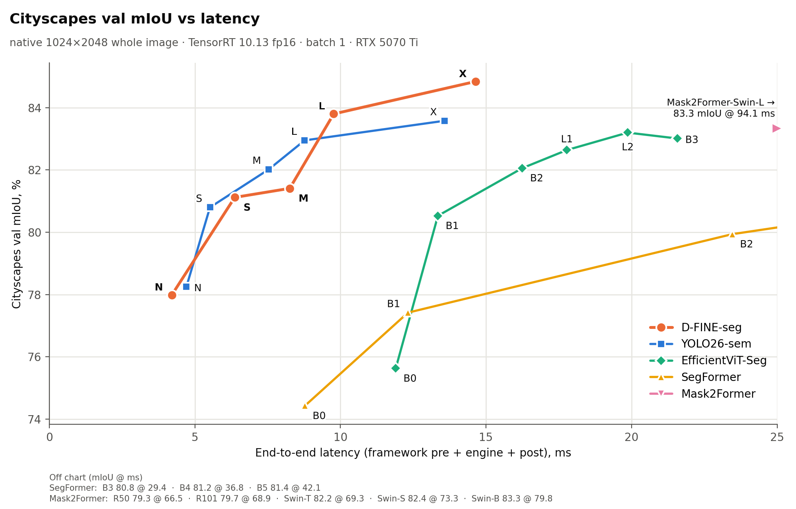

# Cityscapes semantic segmentation at native 1024x2048: results

Generated by `make_results_native.py` from `bench_semseg_native.py` output; no hand-typed numbers. Protocol: [`PROTOCOL.md` §11](../PROTOCOL.md#11-native-resolution-semantic-segmentation). 500 val images, whole 1024x2048 frame, one forward pass, scored at 1024x2048 by one scorer. TensorRT 10.13.3.9 fp16, batch 1, idle GPU. Each framework runs its own pre/postprocess.

| model | params (M) | GMACs | **mIoU** | pixel acc | e2e ms | engine ms | published mIoU (protocol) |
|---|---|---|---|---|---|---|---|
| D-FINE-N | 3.36 | 81.5 | 78.0 | 96.0 | 4.21 | 3.02 |  |
| D-FINE-S | 7.99 | 213.8 | 81.1 | 96.5 | 6.37 | 5.38 |  |
| D-FINE-M | 15.95 | 295.0 | 81.4 | 96.5 | 8.26 | 7.42 |  |
| D-FINE-L | 24.97 | 380.4 | 83.8 | 96.9 | 9.77 | 8.98 |  |
| D-FINE-X | 56.3 | 670.1 | **84.8** | **97.1** | 14.64 | 14.18 |  |
| YOLO26n-sem | 1.63 | 11.9 | 78.2 | 95.8 | 4.71 | 1.26 | 78.3 (whole 1024x2048) |
| YOLO26s-sem | 6.49 | 45.5 | 80.8 | 96.3 | 5.52 | 2.02 | 80.8 (whole 1024x2048) |
| YOLO26m-sem | 14.3 | 152.7 | 82.0 | 96.5 | 7.54 | 4.13 | 82.0 (whole 1024x2048) |
| YOLO26l-sem | 17.85 | 194.1 | 83.0 | 96.7 | 8.77 | 5.44 | 82.9 (whole 1024x2048) |
| YOLO26x-sem | 40.13 | 433.5 | 83.6 | 96.8 | 13.58 | 10.37 | 83.6 (whole 1024x2048) |
| SegFormer-B0 | 3.72 | 121.0 | 74.4 | 95.7 | 8.78 | 5.04 | 76.2 (slide 1024x1024/768) |
| SegFormer-B1 | 13.68 | 239.1 | 77.4 | 96.1 | 12.32 | 8.42 | 78.5 (slide 1024x1024/768) |
| SegFormer-B2 | 27.36 | 703.5 | 79.9 | 96.4 | 23.46 | 19.88 | 81.0 (slide 1024x1024/768) |
| SegFormer-B3 | 47.24 | 949.2 | 80.8 | 96.5 | 29.43 | 26.13 | 81.7 (slide 1024x1024/768) |
| SegFormer-B4 | 64.01 | 1226.8 | 81.2 | 96.5 | 36.78 | 33.58 | 82.3 (slide 1024x1024/768) |
| SegFormer-B5 | 84.61 | 1446.4 | 81.4 | 96.6 | 42.12 | 38.81 | 82.4 (slide 1024x1024/768) |
| EfficientViT-B0 | 0.71 | 4.4 | 75.6 | 95.7 | 11.90 | 1.06 | 75.7 (whole 1024x2048) |
| EfficientViT-B1 | 4.8 | 25.1 | 80.5 | 96.5 | 13.35 | 2.63 | 80.5 (whole 1024x2048) |
| EfficientViT-B2 | 15.32 | 73.6 | 82.1 | 96.7 | 16.25 | 5.65 | 82.1 (whole 1024x2048) |
| EfficientViT-L1 | 40.24 | 282.5 | 82.6 | 96.8 | 17.78 | 7.30 | 82.7 (whole 1024x2048) |
| EfficientViT-L2 | 52.61 | 396.1 | 83.2 | 96.9 | 19.87 | 9.56 | 83.2 (whole 1024x2048) |
| EfficientViT-B3 | 39.6 | 179.2 | 83.0 | 96.9 | 21.58 | 10.74 | 83.0 (whole 1024x2048) |
| Mask2Former-R50 | 44.01 | 519.6 | 79.3 | 96.4 | 66.51 | 36.49 | 79.4 (whole 1024x2048) |
| Mask2Former-R101 | 63.0 | 674.7 | 79.7 | 96.4 | 68.93 | 38.85 | 80.1 (whole 1024x2048) |
| Mask2Former-Swin-T | 47.41 | 533.4 | 82.2 | 96.7 | 69.33 | 39.13 | 82.1 (whole 1024x2048) |
| Mask2Former-Swin-S | 68.72 | 719.4 | 82.4 | 96.8 | 73.32 | 43.11 | 82.6 (whole 1024x2048) |
| Mask2Former-Swin-B | 106.89 | 1045.9 | 83.3 | 96.9 | 79.85 | 50.09 | 83.3 (whole 1024x2048) |
| Mask2Former-Swin-L | 215.46 | 1899.4 | 83.3 | 96.9 | 94.07 | 64.51 | 83.3 (whole 1024x2048) |

`e2e ms` = the framework's own call (decode and D2H off the clock). `engine ms` = TRT execute only, same loop for every engine. GMACs are recounted with one counter (`model_stats.py`) at 1024x2048.

## TRT fp16 correctness gate (same pre/post, PyTorch fp32 model)

| model | TRT fp16 | torch | delta |
|---|---|---|---|
| YOLO26n-sem | 78.2 | 78.3 | -0.01 |
| YOLO26s-sem | 80.8 | 80.8 | +0.00 |
| YOLO26m-sem | 82.0 | 82.0 | +0.00 |
| YOLO26l-sem | 83.0 | 82.9 | +0.01 |
| YOLO26x-sem | 83.6 | 83.6 | +0.00 |
| SegFormer-B0 | 74.4 | 74.4 | +0.00 |
| SegFormer-B1 | 77.4 | 77.4 | +0.00 |
| SegFormer-B2 | 79.9 | 79.9 | +0.00 |
| SegFormer-B3 | 80.8 | 80.8 | +0.00 |
| SegFormer-B4 | 81.2 | 81.2 | +0.00 |
| SegFormer-B5 | 81.4 | 81.4 | +0.00 |
| EfficientViT-B0 | 75.6 | 75.7 | -0.03 |
| EfficientViT-B1 | 80.5 | 80.5 | -0.02 |
| EfficientViT-B2 | 82.1 | 82.1 | -0.01 |
| EfficientViT-B3 | 83.0 | 83.0 | -0.01 |
| EfficientViT-L1 | 82.6 | 82.7 | -0.08 |
| EfficientViT-L2 | 83.2 | 83.2 | -0.03 |
| Mask2Former-R50 | 79.3 | 79.4 | -0.10 |
| Mask2Former-R101 | 79.7 | 80.1 | -0.39 |
| Mask2Former-Swin-T | 82.2 | 82.1 | +0.06 |
| Mask2Former-Swin-S | 82.4 | 82.6 | -0.13 |
| Mask2Former-Swin-B | 83.3 | 83.3 | -0.04 |
| Mask2Former-Swin-L | 83.3 | 83.4 | -0.02 |

## SegFormer reproduction (their sliding-window protocol, torch)

| model | ours (slide) | paper | delta |
|---|---|---|---|
| SegFormer-B0 | 76.2 | 76.2 | -0.01 |
| SegFormer-B1 | 78.4 | 78.5 | -0.12 |
| SegFormer-B2 | 80.8 | 81.0 | -0.18 |
| SegFormer-B3 | 81.5 | 81.7 | -0.20 |
| SegFormer-B4 | 82.5 | 82.3 | +0.18 |
| SegFormer-B5 | 82.2 | 82.4 | -0.18 |

## Per-class IoU (TRT)

| model | road | sidewalk | building | wall | fence | pole | traffic-light | traffic-sign | vegetation | terrain | sky | person | rider | car | truck | bus | train | motorcycle | bicycle |
|---|---|---|---|---|---|---|---|---|---|---|---|---|---|---|---|---|---|---|---|
| D-FINE-N | 98.1 | 84.7 | 92.2 | 64.2 | 62.9 | 64.3 | 72.0 | 79.0 | 92.3 | 66.1 | 94.5 | 81.3 | 62.4 | 94.6 | 76.4 | 82.3 | 81.4 | 56.9 | 76.4 |
| D-FINE-S | 98.3 | 85.9 | 93.2 | 65.5 | 63.9 | 69.2 | 75.8 | 82.6 | 92.8 | 65.7 | 95.3 | 84.8 | 70.6 | 95.7 | 82.1 | 88.9 | 82.7 | 68.5 | 79.9 |
| D-FINE-M | 98.4 | 86.8 | 93.1 | 62.4 | 66.7 | 69.1 | 76.3 | 83.0 | 93.0 | 68.9 | 95.2 | 85.2 | 69.8 | 95.6 | 83.0 | 91.1 | 81.7 | 67.8 | 79.7 |
| D-FINE-L | 98.7 | 88.7 | 93.9 | 65.9 | 67.2 | 72.6 | 77.4 | 83.9 | 93.3 | 66.9 | 95.8 | 87.4 | 74.5 | 96.2 | 88.5 | 94.0 | 89.4 | 75.6 | 82.2 |
| D-FINE-X | 98.8 | 89.7 | 94.2 | 68.3 | 68.8 | 73.3 | 78.6 | 85.3 | 93.6 | 69.1 | 95.8 | 88.1 | 75.8 | 96.5 | 91.0 | 94.8 | 89.1 | 78.4 | 83.0 |
| YOLO26n-sem | 97.9 | 83.3 | 91.9 | 54.1 | 61.9 | 62.9 | 72.2 | 78.2 | 92.1 | 64.2 | 94.6 | 81.8 | 65.0 | 94.6 | 83.4 | 86.1 | 82.2 | 64.1 | 76.4 |
| YOLO26s-sem | 98.2 | 85.4 | 92.8 | 59.8 | 66.1 | 66.8 | 75.6 | 81.9 | 92.8 | 66.7 | 94.8 | 84.0 | 69.2 | 95.3 | 84.5 | 89.5 | 84.5 | 68.2 | 79.2 |
| YOLO26m-sem | 98.2 | 85.4 | 93.2 | 62.3 | 65.9 | 69.0 | 77.0 | 83.6 | 92.9 | 66.2 | 95.0 | 85.3 | 70.6 | 95.8 | 88.3 | 90.4 | 85.6 | 73.0 | 80.7 |
| YOLO26l-sem | 98.4 | 86.6 | 93.3 | 63.8 | 67.1 | 70.1 | 76.9 | 84.4 | 93.1 | 69.1 | 94.8 | 85.8 | 71.3 | 96.0 | 87.4 | 92.0 | 87.1 | 77.1 | 81.5 |
| YOLO26x-sem | 98.5 | 87.2 | 93.6 | 64.3 | 69.6 | 71.2 | 78.0 | 85.4 | 93.2 | 68.1 | 95.2 | 86.8 | 74.0 | 96.3 | 89.0 | 94.1 | 83.7 | 77.8 | 82.3 |
| SegFormer-B0 | 97.9 | 83.5 | 91.7 | 52.4 | 52.5 | 61.5 | 68.2 | 75.9 | 92.2 | 63.7 | 94.7 | 79.4 | 54.1 | 93.8 | 65.4 | 80.4 | 70.4 | 61.0 | 75.6 |
| SegFormer-B1 | 98.2 | 85.4 | 92.3 | 56.6 | 56.5 | 64.8 | 71.7 | 79.5 | 92.7 | 64.1 | 95.0 | 81.7 | 59.2 | 94.9 | 79.7 | 84.8 | 68.5 | 67.7 | 77.7 |
| SegFormer-B2 | 98.3 | 86.2 | 93.0 | 59.1 | 58.5 | 68.5 | 75.1 | 81.2 | 93.1 | 64.6 | 95.3 | 83.6 | 64.2 | 95.3 | 81.3 | 86.8 | 83.6 | 71.8 | 79.3 |
| SegFormer-B3 | 98.5 | 86.8 | 93.2 | 61.4 | 62.6 | 68.8 | 74.9 | 81.4 | 93.1 | 65.8 | 95.3 | 84.0 | 64.9 | 95.4 | 84.7 | 89.1 | 83.8 | 71.2 | 79.5 |
| SegFormer-B4 | 98.4 | 86.8 | 93.3 | 61.7 | 62.4 | 69.6 | 75.1 | 81.5 | 93.1 | 66.5 | 95.3 | 84.5 | 66.3 | 95.4 | 83.2 | 91.0 | 85.6 | 72.3 | 79.8 |
| SegFormer-B5 | 98.5 | 87.4 | 93.3 | 63.6 | 63.2 | 69.4 | 75.1 | 81.8 | 93.0 | 66.6 | 95.5 | 84.6 | 67.9 | 95.5 | 85.0 | 91.4 | 82.0 | 72.7 | 80.0 |
| EfficientViT-B0 | 98.0 | 83.8 | 91.7 | 60.2 | 58.9 | 59.4 | 66.6 | 74.9 | 92.1 | 63.5 | 94.6 | 78.3 | 54.0 | 94.1 | 70.5 | 86.7 | 76.4 | 59.6 | 73.7 |
| EfficientViT-B1 | 98.4 | 86.5 | 93.1 | 61.0 | 65.5 | 67.3 | 73.6 | 81.2 | 93.1 | 67.3 | 95.0 | 82.9 | 62.9 | 95.8 | 86.6 | 90.4 | 84.2 | 67.0 | 78.3 |
| EfficientViT-B2 | 98.5 | 87.5 | 93.5 | 65.9 | 66.7 | 69.7 | 75.7 | 82.9 | 93.2 | 66.1 | 95.2 | 84.8 | 68.3 | 96.0 | 88.7 | 91.6 | 85.1 | 70.0 | 79.7 |
| EfficientViT-B3 | 98.6 | 88.2 | 93.8 | 66.8 | 66.4 | 71.0 | 76.7 | 84.0 | 93.4 | 68.8 | 95.4 | 85.2 | 69.0 | 96.2 | 90.0 | 93.2 | 87.8 | 72.2 | 80.4 |
| EfficientViT-L1 | 98.5 | 88.0 | 93.7 | 67.9 | 66.1 | 70.3 | 76.0 | 83.3 | 93.3 | 67.6 | 95.2 | 84.9 | 67.5 | 96.1 | 88.1 | 93.4 | 87.8 | 72.3 | 80.0 |
| EfficientViT-L2 | 98.6 | 88.2 | 93.9 | 62.8 | 68.9 | 71.5 | 76.6 | 83.9 | 93.4 | 67.8 | 95.4 | 85.7 | 69.8 | 96.4 | 89.0 | 93.3 | 89.3 | 75.2 | 81.2 |
| Mask2Former-R50 | 98.4 | 86.9 | 93.0 | 58.2 | 62.8 | 70.2 | 75.2 | 82.4 | 92.8 | 64.8 | 95.1 | 84.3 | 66.0 | 95.7 | 68.7 | 82.1 | 80.8 | 69.4 | 79.8 |
| Mask2Former-R101 | 98.3 | 86.1 | 92.9 | 56.2 | 61.2 | 69.5 | 75.0 | 81.5 | 92.9 | 65.6 | 95.1 | 84.3 | 67.5 | 95.4 | 85.1 | 89.3 | 69.4 | 69.3 | 80.1 |
| Mask2Former-Swin-T | 98.4 | 87.1 | 93.6 | 65.6 | 67.1 | 69.8 | 75.9 | 82.4 | 93.1 | 66.0 | 95.2 | 85.2 | 69.1 | 95.9 | 88.5 | 92.2 | 83.6 | 72.2 | 80.7 |
| Mask2Former-Swin-S | 98.6 | 88.5 | 93.8 | 65.1 | 66.4 | 71.1 | 76.2 | 83.9 | 93.3 | 68.5 | 95.3 | 85.3 | 68.6 | 95.9 | 86.2 | 92.2 | 83.5 | 72.9 | 81.1 |
| Mask2Former-Swin-B | 98.6 | 88.7 | 93.9 | 66.8 | 69.8 | 71.4 | 76.2 | 83.9 | 93.4 | 68.2 | 95.6 | 86.0 | 70.5 | 96.1 | 89.6 | 92.7 | 85.1 | 74.5 | 81.5 |
| Mask2Former-Swin-L | 98.7 | 88.9 | 94.0 | 67.9 | 68.6 | 72.0 | 77.0 | 83.6 | 93.3 | 65.7 | 95.6 | 86.3 | 71.4 | 96.0 | 90.2 | 91.9 | 85.2 | 75.0 | 82.1 |
